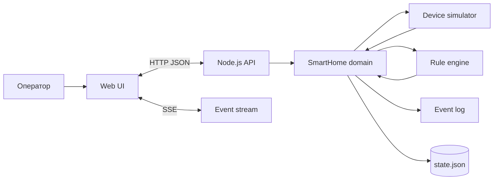

# Архитектура Smart Home PRO

## Контекст

Вариант SIM — законченный вертикальный срез продукта, который запускается на одном компьютере. Браузер — операторская панель, Node.js — API и доменный сервис, JSON — локальное хранилище состояния.

## Поток команды

1. Пользователь меняет значение устройства.
2. UI отправляет `PATCH /api/devices/:id`.
3. API разбирает JSON и вызывает доменную команду.
4. Домен проверяет существование, доступность, тип и диапазон значения.
5. Состояние меняется, создаётся событие, запускаются связанные правила (если есть).
6. Состояние записывается в файл; SSE рассылает актуальный snapshot клиентам.

## Модель данных

- `Device`: id, name, type, room, status, enabled, value, unit, meta, updatedAt.
- `Rule`: id, name, description, trigger, enabled, actions[], lastRun.
- `Event`: id, type, title, description, deviceId, severity, at.
- `Settings`: имя дома, режим симуляции, уведомления, дневной лимит энергии.
- `Metrics`: потребление за день/месяц, оценка экономии, uptime (демо-метрики).

## Расширение до IoT

Доменный слой не должен знать детали протокола устройства. Для физического пилота добавляется порт `DeviceAdapter` с командами `readState`, `setValue`, `subscribe`. Реализации MQTT/HTTP/RTSP подключаются через реестр адаптеров. В этой версии адаптер симулятора — единственный активный источник данных.

## Нефункциональные характеристики

- Основной сценарий работает без облачного подключения.
- API отделён от UI и может использоваться мобильным клиентом.
- Команды валидируются до изменения состояния.
- Поток событий обновляет интерфейс без периодического опроса.
- Тесты запускаются стандартным Node test runner без сторонних библиотек.
